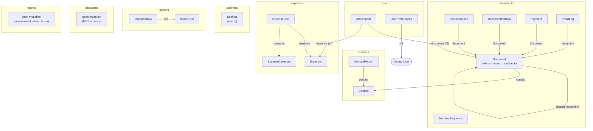

# Architectuur

Een kaart van de code voor wie Huismus voor het eerst openslaat: welke
Django-apps er zijn, welke modellen erin staan en hoe ze samenhangen, en wat
elke map doet. Het *waarom* van het ontwerp staat in `SPEC.md`; de afspraken
voor bijdragen in `CONTRIBUTING.md` en `CLAUDE.md`. Factuureisen met
bronnen: `docs/invoice-requirements.md`.

Huismus is één Django-project met zeven apps. Alle code staat in `huismus/`:
de apps, de instellingen (`huismus/config/`), de templates en de vertalingen.
De hoofdmap bevat alleen wat eromheen hoort: tests, docs, de desktop-app,
Docker, uitrollen en scripts. Server-rendered templates met HTMX, SQLite, geen
JS-framework.

## Apps en modellen

Een pijl is een `ForeignKey` (de naam van het veld staat erbij). Alle
modellen erven van het abstracte `core.TimestampedModel` (`created_at`,
`updated_at`); dat staat niet in het diagram. Een paar dingen die je niet
uit het diagram haalt:

- **Eén tabel voor drie soorten documenten.** Offerte, factuur en creditnota
  zijn allemaal een `Document`, met `kind`. Welke `status` mag, hangt af van
  de soort (`ALLOWED_STATUSES_BY_KIND` in `huismus/documents/models.py`).
  `related_document` wijst van een creditnota naar de factuur die hij
  corrigeert, en van een factuur naar de offerte waaruit hij gemaakt is.
- **`Settings` is de enige rij met bedrijfsgegevens** (altijd `pk=1`). Een
  uitgegeven document leest er nooit meer uit: het heeft zijn eigen
  snapshots (`contact_snapshot`, `business_snapshot`, `kor_text_snapshot`).
- **`Attachment` staat in `core`**, omdat zowel `documents` (de originele pdf
  uit Moneybird) als `expenses` (bonnetjes) ernaar wijzen; zo hoeven die twee
  apps niet van elkaar af te hangen. Een bijlage hoort bij een document óf
  een uitgave. Alleen een bonnetje uit de bonnetjesmap hoort even bij geen
  van beide, tot je er een uitgave van maakt (`expenses/inbox.py`, M20).
- **`NumberSequence`** heeft geen relaties: één rij per soort (en per jaar
  als de nummering jaarlijks opnieuw begint). Nummers deelt alleen
  `documents.numbering` uit; de Moneybird-import zet de teller daarnaast
  op het hoogste geïmporteerde nummer (`huismus/imports/commit.py`), zodat de
  nummering daarna doorloopt.
- **`ImportRun`** legt elke import vast, ook een proefdraai, met de hashes
  van de bestanden en het rapport. Geïmporteerde rijen herken je aan `source`
  en `external_id` op `Contact`, `Document` en `Expense`.
- **`ImportedRow`** bewaart bij een echte import elke rij van de tabbladen die
  de import leest, cel voor cel, ook de kolommen die Huismus niet overneemt
  of niet kent (`huismus/imports/columns.py`). Samen met de originele export
  in `data/import-archief/` (`huismus/imports/archive.py`) gaat er zo niets
  uit een export verloren. Een rij die al bewaard is, komt er niet nog eens in.
  De proefdraai vergelijkt de facturen daarna met Moneybirds eigen
  omzetrapport en btw-overzicht uit dezelfde export (lezen:
  `huismus/imports/reports.py`, vergelijken: `huismus/imports/report_check.py`).
  De regels van een verstuurde factuur komen uit zijn UBL-bestand als dat
  bij de factuur past, anders uit de Excel-export (`huismus/imports/ubl.py`):
  zo krijgen facturen met prijzen inclusief btw de prijzen zonder btw.
- `SPEC.md` noemt ook een `AuditLog`; die bestaat nog niet.

## Wat doet welke app

| App | Wat | Belangrijkste bestanden |
| --- | --- | --- |
| `core` | Alles wat niet bij één domein hoort: inloggen, het overzicht, back-ups (lokaal en in de cloud), de export (één ZIP met CSV's en pdf's), updates en de koppeling met de desktop-app, onboarding, hulp, nepdata, PWA. | `models.py` (`TimestampedModel`, `Attachment`), `dashboard.py`, `backup.py`, `auto_backups.py`, `cloud_backups.py`, `export.py`, `csv_files.py` (de ene CSV-vorm), `maintenance.py`, `onboarding.py`, `help.py`, `demo_history.py`, `templatetags/money.py` |
| `business` | Instellingen: bedrijfsgegevens, de KOR-instellingen van de gebruiker (aan/uit, de tekst op de factuur), nummerformaten, logo, mailserver. | `models.py` (`Settings`), `topics.py`, `kor_limit.py`, `smtp.py`, `svg_sanitize.py` |
| `contacts` | Klanten en hun contactpersonen. | `models.py`, `numbering.py` (klantnummers) |
| `documents` | Offertes, facturen en creditnota's: bewerken, uitgeven, pdf, betalingen, mailen. Het hart van Huismus. | `totals.py`, `issuing.py`, `numbering.py`, `reopening.py`, `snapshots.py`, `quoting.py`, `drafts.py`, `pdf.py`, `mailing.py` |
| `expenses` | Uitgaven met regels (elk een eigen categorie, zoals in Moneybird), categorieën, bonnetjes, en de bonnetjesmap die bonnetjes van onderweg ophaalt. | `models.py`, `lines.py` (de regels en het totaal van een uitgave), `receipts.py`, `inbox.py` (de bonnetjesmap) |
| `reports` | Rapporten, nu alleen het jaaroverzicht: omzet, kosten en winst per kwartaal en per categorie, de KOR-grens, CSV. Alleen lezen. | `year_overview.py`, `views.py` |
| `imports` | De Moneybird-import: herkennen, inlezen, proefdraai, doorvoeren, en bewaren wat er in de export stond. | `pipeline.py`, `detect.py`, `columns.py` (waar elke kolom heen gaat), `archive.py` (ruwe rijen en de originele export), `contacts.py`, `invoices.py`, `quotes.py`, `expenses.py` (inkomende documenten → uitgaven met bonnetjes), `commit.py`, `staging.py` |
| `assistants` | De koppeling met AI-assistenten via MCP op `/mcp`, en de pagina Instellingen → AI-assistenten. | `protocol.py`, `tools.py`, `key.py`, `views.py` |

Welke app welke andere gebruikt (imports in de code, zonder migraties en
tests):

| App | Gebruikt |
| --- | --- |
| `contacts` | `core`, `business`, `documents` |
| `documents` | `core`, `business`, `contacts` |
| `expenses` | `core`, `documents` |
| `reports` | `core`, `business`, `documents`, `expenses` |
| `imports` | `core`, `business`, `contacts`, `documents` |
| `assistants` | `core`, `business`, `contacts`, `documents`, `expenses`, `reports` |
| `business` | `core`, `documents`, `reports`, `assistants` |
| `core` | `business`, `contacts`, `documents`, `expenses`, `reports`, `assistants` (overzicht, back-ups, export, nepdata) |

Imports binnen een functie tellen mee. Er is dus geen strikte gelaagdheid,
en er zijn kringen: `business` haalt de MCP-sleutel en de pagina
AI-assistenten uit `assistants` (die pagina hoort bij Instellingen) en
toont het volgende factuurnummer uit `documents`; `contacts` telt de
documenten van een klant. Dat is zo gegroeid, niet ontworpen. De regel is niet "wie mag wie
importeren", maar: elke handeling met geld of nummers loopt via de ene
functie die ervoor bestaat (zie hieronder). De MCP-tools in `assistants`
roepen bijvoorbeeld dezelfde `issue()` aan als de knop in de app.

## Eén verzoek gevolgd: een factuur uitgeven

Om te zien hoe de stukken samenwerken, de knop "Uitgeven" op een concept:

1. `huismus/config/urls.py` stuurt `/facturen/…` naar `huismus/documents/urls.py`; daar wijst
   `<pk>/uitgeven/` naar de view `document_issue` in `huismus/documents/views.py`.
2. De view roept `issue()` aan in `huismus/documents/issuing.py`. Daar gebeurt alles
   in één transactie: de totalen uit `huismus/documents/totals.py`, het nummer uit
   `huismus/documents/numbering.py`, de snapshots uit `huismus/documents/snapshots.py`, de
   omzet en btw per tarief (`DocumentVatRow`, via `huismus/documents/vat_snapshot.py`), en
   de status wordt `issued`.
3. Vanaf dan houden `Document.save()` en de SQLite-triggers elke wijziging
   tegen.
4. De pagina van het document (`huismus/documents/detail.py`, templates in
   `huismus/templates/documents/`) en de pdf (`huismus/documents/pdf.py`, template in
   `huismus/templates/pdf/`) lezen uit de snapshots en de opgeslagen totalen, niet
   uit de instellingen of de klant.

## Waar de harde regels wonen

De zeven harde regels staan in `CLAUDE.md` ("Hard rules") en, met de
achtergrond, in `SPEC.md` sectie 5. Hier alleen waar je ze in de code vindt:

| Regel | Waar |
| --- | --- |
| 1. Geld in centen | Velden `*_cents` (`BigIntegerField`), btw-tarieven in basispunten; weergeven met `huismus/core/templatetags/money.py`. |
| 2. Uitgegeven is onveranderlijk | `Document.save()`/`delete()`, `DocumentLine` en `DocumentVatRow` (btw per tarief, vastgelegd bij uitgeven) in `huismus/documents/models.py`, plus SQLite-triggers in `huismus/documents/migrations/0003_immutability_triggers.py` en `0008_document_reopened_at.py`, `0016_vat_rows.py` (en `0010_emaillog_append_only_triggers.py` voor `EmailLog`; zoek op `TRIGGER` in `huismus/documents/migrations/`). De enige uitzondering: `huismus/documents/reopening.py` ("Toch bewerken"). |
| 3. Nummers zonder gaten | `huismus/documents/numbering.py` (`allocate_number`, via `number_for`), op dit moment alleen aangeroepen vanuit `huismus/documents/issuing.py` (factuur, creditnota) en `huismus/documents/quoting.py` (offerte versturen), binnen de transactie die het document uitgeeft of verstuurt. |
| 4. Eén totalenfunctie | `huismus/documents/totals.py` (`compute_totals`), voor scherm, pdf en import. |
| 5. Snapshots | `huismus/documents/snapshots.py`, vastgelegd in `huismus/documents/issuing.py`. |
| 6. Import idempotent, eerst proefdraaien | `huismus/imports/pipeline.py` en `huismus/imports/commit.py`. Kolommen op koptekst: `huismus/imports/detect.py`; waar elke kolom heen gaat, en welke verplicht is: `huismus/imports/columns.py`. |
| 7. Uitgaven bruto | `Expense.amount_cents` en `ExpenseLine.amount_cents` in `huismus/expenses/models.py`, het totaal als som van de regels in `huismus/expenses/lines.py`; `vat_info_cents` is alleen ter info. |

## Wat doet welke map

| Map | Wat |
| --- | --- |
| `huismus/assistants/`, `huismus/business/`, `huismus/contacts/`, `huismus/core/`, `huismus/documents/`, `huismus/expenses/`, `huismus/imports/` | De apps, zie hierboven. Elke app heeft de gebruikelijke Django-indeling (`models.py`, `views.py`, `urls.py`, `forms.py`, `migrations/`); de logica staat in eigen modules. De apptabel hierboven noemt alleen de belangrijkste; elk bestand begint met een docstring die zegt wat het doet. |
| `huismus/config/` | Het Django-project: `settings.py`, `settings_test.py` (voor pytest), `urls.py` (alle adressen op één plek) en `secret_key.py`. |
| `huismus/templates/` | Alle HTML-templates, in een map per onderwerp (meestal per app; de pagina AI-assistenten staat bij `huismus/business/`), plus `base.html`, `pdf/` (de pdf's), `registration/` (inloggen), `errors/` en `icons.svg`. |
| `huismus/core/static/core/` | De ene stylesheet (`huismus.css`), het ene script (`app.js`, alleen voor gemak bovenop gewone formulieren), HTMX in `vendor/`, en de app-iconen. Hoe de schermen in elkaar zitten: `docs/frontend.md`. |
| `huismus/locale/` | Vertalingen (`nl`, `en`), gemaakt met `makemessages`. |
| `tests/` | Een map per app, plus `desktop/`, `e2e/` (browsertests met Playwright) en `fixtures/` (fictieve Moneybird-exports). |
| `desktop/` | De desktop-app voor macOS en Windows: een venster om dezelfde Django-app heen. Zie `docs/desktop.md`. |
| `docker/` | `entrypoint.sh` voor de container; het `Dockerfile` staat in de hoofdmap. |
| `scripts/` | `verify.sh` (de poort), `demo-server.sh`, `site-beelden.sh` en `promo-film.sh` (beelden en filmpje van de app), en bouwscripts voor de desktop-app en het design system. |
| `docs/` | Documentatie; `docs/README.md` zegt wat voor wie is. `docs/hulp/` is de uitleg die de app zelf toont. |
| `.claude/`, `.github/` | De werkwijze met Claude Code (agents, skills, hooks) en CI. |

## Waarom de apps in `huismus/` staan

Zo zie je in de hoofdmap meteen wat de app is en wat gereedschap eromheen.
Het Python-pakket heet daarom `huismus` (`from huismus.documents import totals`),
maar elke app houdt zijn korte label (`AppConfig.label`: `core`, `documents`,
...). Dat label noemt de tabellen, de migraties en wat er in een back-up staat,
dus de database en oude back-ups merken niets van de verhuizing. Een nieuwe
app maak je met `mkdir huismus/<naam>` en `manage.py startapp <naam> huismus/<naam>`, met
`name = "huismus.<naam>"` en `label = "<naam>"` in `apps.py`. Besluit:
`huismus-intern/besluiten.md`, 2026-10-31 "Code van Huismus in één map".
